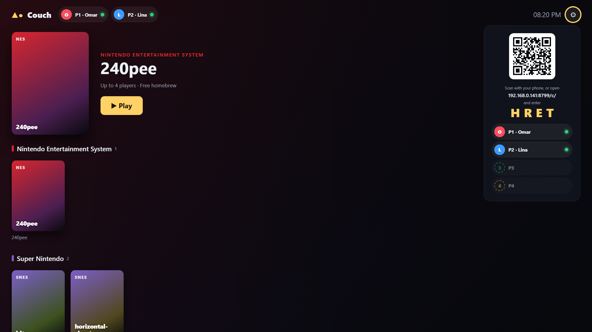
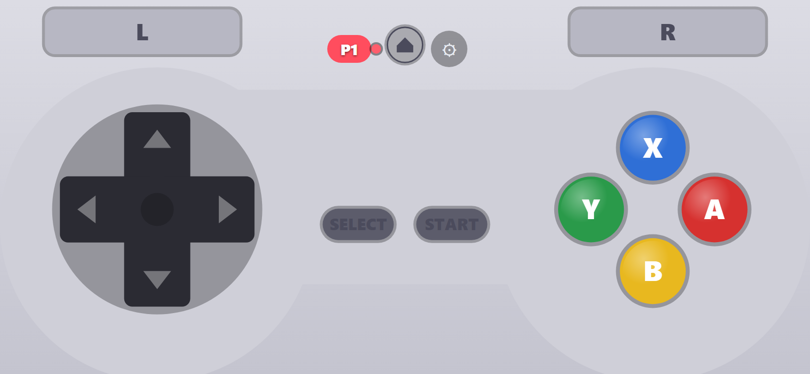
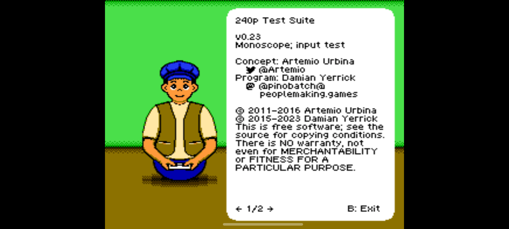

# Couch: a retro console where phones are the controllers

The TV shows your game library and a QR code. Everyone scans it and their phone becomes a controller
for the game on the TV: a SNES pad for SNES games, a DualShock for PS1, an N64 pad with C-buttons. No app to
install. Up to 4 players (8 optional), drop-in/drop-out, reconnects keep your slot.

| TV (web host) | Phone controller | Android TV app |
|---|---|---|
|  |  |  |

**Measured latency** (phone → console, Galaxy S21 on 5 GHz Wi-Fi, real game running): one-way
**p50 5 ms, p95 9.5 ms**, against a budget of p95 ≤ 20 ms. See [docs/LATENCY.md](docs/LATENCY.md).

## Two ways to run the TV side

### 1. Laptop/PC → HDMI → TV (web host)

Needs Node 22+ and pnpm 9.

```sh
pnpm install
pnpm test-roms     # optional: free homebrew games to try
pnpm cores         # downloads the emulator cores (~150 MB, once)
pnpm build
pnpm start         # → open http://localhost:8787 on the TV/laptop
```

- Put your own games in [`roms/<system>/`](roms/README.md). They stay on your machine and are never committed.
- Phones scan the QR code. Phone and computer must be on the same Wi-Fi.
  If Windows asks, allow Node.js on **private networks**.
- PSP needs cross-origin isolation: start with `COI=1 pnpm start`, keep the TV page on `localhost`,
  and enable *PSP (experimental)* in Settings.
- Systems: NES, SNES, Genesis, GB/GBC, GBA everywhere. PS1, NDS and PSP on desktop-class CPUs.
  N64 and PS2 need the Android app.

### 2. Android TV / Google TV box (native host)

```sh
pnpm install && pnpm --filter @couch/controller-web build && pnpm --filter @couch/systems export-json
cd apps/host-android-tv
./gradlew :app:assembleDebug        # needs JDK 21 + Android SDK (API 37 downloads automatically)
adb install -r app/build/outputs/apk/debug/app-debug.apk
```

- The app is its own server: phones open `http://<tv-ip>:8787/c/` (shown as a QR code on screen). No computer or
  internet is needed while playing.
- Games: `roms/<system>/` on a USB drive, in Documents or Download (grant "All files access"), or in
  `Android/data/app.couch.tv/files/roms/` (no permission needed, `adb push` works).
- Emulator cores download from the libretro buildbot the first time you play each system.
- Systems are shown according to the device's measured performance tier (Settings → Performance tier).

### 3. Hosted on a server (Docker / Coolify, public HTTPS mode)

`docker compose up -d --build` runs everything in one container. Behind HTTPS, phones can join over the
internet and PSP works on any TV browser. See [`docs/DEPLOY.md`](docs/DEPLOY.md).

## Repository

| Path | What |
|---|---|
| `apps/controller-web` | Phone controller (Preact, framework-free input hot path, SVG skins, haptics, gyro) |
| `apps/host-web` | TV app in the browser (React, Nostalgist.js + RetroArch/EmulatorJS WASM cores) |
| `apps/host-android-tv` | TV app for Android TV (Kotlin, Compose for TV, LibretroDroid, Ktor, libwebrtc) |
| `apps/signaling` | Couch server: rooms, WebRTC signaling, WebSocket relay, ROM library + metadata, static hosting |
| `packages/protocol` | Binary wire protocol, clock sync, link stats, golden vectors shared with Kotlin |
| `packages/net` | Browser transport: WebSocket first, WebRTC DataChannel upgrade |
| `packages/skins` | Controller layouts per console |
| `packages/systems` | System catalog: extensions, cores per host, performance tiers |
| `packages/latency-lab` | Benchmarks behind the ADRs (transport, engine, real phone over adb) |
| `e2e/` | Playwright end-to-end tests (pairing, gameplay input, save states, heavy systems, latency regression) |

Docs: [BRIEF](docs/BRIEF.md) · [Milestones, test results & known issues](docs/MILESTONES.md) ·
[ADRs](docs/decisions) · [Latency](docs/LATENCY.md) · [Licences](docs/LICENSES.md) · [Deviations from the brief](docs/DEVIATIONS.md)

## Tests

```sh
pnpm test                    # unit tests (protocol, skins, systems, server)
pnpm typecheck
pnpm e2e                     # Playwright (needs pnpm build, pnpm test-roms, pnpm cores)
cd apps/host-android-tv && ./gradlew :app:testDebugUnitTest   # Kotlin codec vs golden vectors
```

## Licence

GPL-3.0-or-later. Emulator cores are separate programs with their own licences ([docs/LICENSES.md](docs/LICENSES.md)).
snes9x and Genesis Plus GX are **non-commercial**. Read [ADR-004](docs/decisions/ADR-004-core-licensing.md) before
any monetisation. No ROMs or BIOS files are included or downloaded, except freely distributable homebrew on request.
