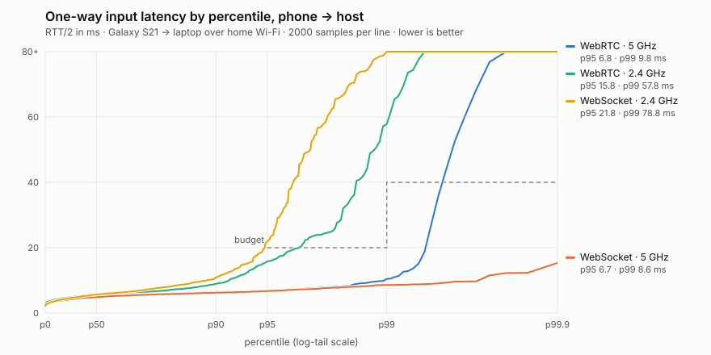

# Latency report

Budget (brief §5), from touch on the phone to input visible to the core: **p95 ≤ 20 ms, p99 ≤ 40 ms on 5 GHz**.

## The latency chain

| Stage | Typical | How we keep it small |
|---|---|---|
| Touch → `pointerdown` handler (phone) | 4–10 ms (touch scan rate, OS; outside our control) | `touch-action: none`, Pointer Events, no click delay, no framework on the hot path |
| Handler → packet on the wire | < 0.1 ms | Encode into a preallocated buffer and send synchronously in the handler: no rAF wait, no React render |
| Wire (Wi-Fi) | 5 GHz p50 ≈ 5 ms, p95 ≈ 7 ms · 2.4 GHz p95 16–22 ms | Unordered/0-retransmit DataChannel; never queue (drop if `bufferedAmount` > 256 B) |
| Host receive → core-visible state | < 0.1 ms + frame-poll wait 0–16.7 ms (mean 8.3) | State written in place; the core reads it at its next `input_poll` (virtual gamepad / `simulate_input` / LibretroDroid events) |
| Core → photons | 1–3 frames (game logic + TV) | Out of scope; run-ahead is available as an option (M6) |

**Our layer** (handler → core-visible) measured on 5 GHz: **p95 6.7 ms, p99 8.6–9.8 ms**, inside budget. On 2.4 GHz the tail misses p99 (58–79 ms). The TV flags such players.

**Product-level check** (real controller page, real TV app, SNES game running, S21 on 5 GHz, `scripts/bench-ingame.ts`): one-way **p50 5 ms, p95 9.5 ms**, jitter 2.3 ms, loss 0.13 %, WebRTC P2P.

## How to reproduce

```sh
pnpm install && pnpm test-roms && pnpm cores
pnpm --filter @couch/latency-lab build
# Real phone (USB debugging on, same Wi-Fi as this PC):
pnpm --filter @couch/latency-lab bench:phone -- --label=myhome
# Loopback matrix (software floor, 1 vs 4 phones, emulated cloud relay):
pnpm --filter @couch/latency-lab bench:transport
# Rebuild this report + chart:
pnpm --filter @couch/latency-lab exec tsx scripts/report.ts
```

Manual phone run without adb: open `http://<pc-ip>:8787/lab/host.html` on the PC and `http://<pc-ip>:8787/lab/phone.html?room=XXXX` on the phone. Results are saved to `packages/latency-lab/results/raw/` when the couch server runs with `LAB=1`.

## Debugging latency in the product

- **TV**: press `L` on a keyboard, or choose *Show latency overlay* in the in-game menu (Home button on any phone), to show the per-player overlay (transport, RTT, one-way p50/p95, jitter, loss, fps).
- **Phone**: triple-tap the player badge to show echo-RTT and packet counters.

<!-- RESULTS -->
<!-- generated by packages/latency-lab/scripts/report.ts — edit the narrative in docs/LATENCY.md above the marker only -->

### Phone over Wi-Fi (real radio)



| Transport | Band | n | p50 ms | p95 ms | p99 ms | max ms | jitter ms | loss % | connect ms |
|---|---|---|---|---|---|---|---|---|---|
| WebRTC | 5 GHz | 2000 | 4.95 | 6.75 | 9.80 | 109.70 | 1.11 | 0.00 | 2088 |
| WebSocket | 5 GHz | 2000 | 4.90 | 6.70 | 8.60 | 17.90 | 1.39 | 0.00 | 28 |
| WebRTC | 2.4 GHz | 1997 | 5.70 | 15.80 | 57.75 | 132.30 | 2.33 | 0.15 | 2208 |
| WebSocket | 2.4 GHz | 2000 | 5.65 | 21.80 | 78.80 | 95.60 | 3.75 | 0.00 | 64 |

### Loopback (software floor: same PC, separate Chromium processes)

WAN one-way delay injected for the cloud-relay row: 20 ms (half the measured TCP connect time to a Cloudflare edge).

| Scenario | Transport | p50 ms | p95 ms | p99 ms | max ms | loss % |
|---|---|---|---|---|---|---|
| webrtc-1 | WebRTC P2P | 0.40 | 0.50 | 0.65 | 1.35 | 0.00 |
| ws-lan-1 | WebSocket relay | 0.50 | 0.75 | 1.00 | 2.45 | 0.00 |
| ws-cloud-1 | WebSocket relay | 25.65 | 33.25 | 33.80 | 34.65 | 0.00 |
| webrtc-4 (phone 1) | WebRTC P2P | 0.30 | 0.50 | 0.70 | 4.65 | 0.00 |
| webrtc-4 (phone 2) | WebRTC P2P | 0.35 | 0.50 | 0.80 | 4.60 | 0.00 |
| webrtc-4 (phone 3) | WebRTC P2P | 0.35 | 0.50 | 0.65 | 2.40 | 0.00 |
| webrtc-4 (phone 4) | WebRTC P2P | 0.40 | 0.55 | 0.80 | 3.40 | 0.00 |
| ws-lan-4 (phone 1) | WebSocket relay | 0.60 | 1.05 | 1.80 | 209.00 | 0.00 |
| ws-lan-4 (phone 2) | WebSocket relay | 0.60 | 1.20 | 2.05 | 6.75 | 0.00 |
| ws-lan-4 (phone 3) | WebSocket relay | 0.60 | 1.10 | 2.05 | 8.45 | 0.00 |
| ws-lan-4 (phone 4) | WebSocket relay | 0.55 | 1.00 | 1.95 | 8.60 | 0.00 |
